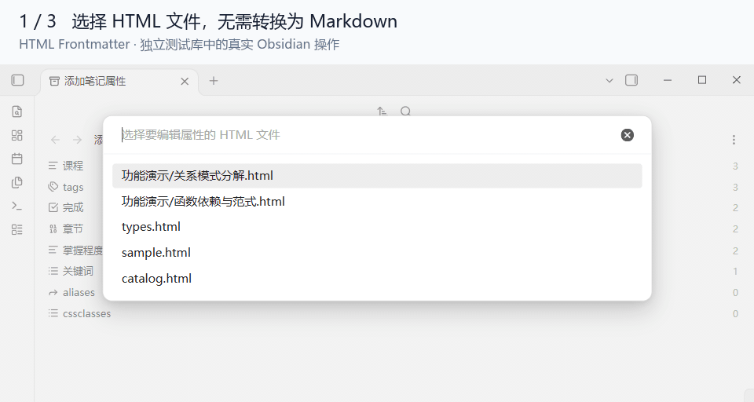

# HTML Frontmatter

[English](README.md) · 简体中文

让 HTML 笔记使用 Obsidian 原生 Properties：编辑属性、查看全库属性目录与统计。属性保存在 HTML 自身的 JSON 数据块中，不生成辅助 Markdown，也不依赖第三方 HTML 插件。

**试用版 · 仅支持桌面 Obsidian 1.14.4，已在 Windows 验证。**

> **Vibe coding 产物**：本项目主要通过人机协作、AI 辅助编码开发。已完成下文链接中记录的实际验证，覆盖范围和已知限制也一并公开；当前仍是试用版。

## 功能

- 通过原生文件属性侧栏编辑文本、列表、数字、复选框、日期、日期时间和标签。
- 支持单文件属性新增、改名、删除；保存时保留 JSON 数据块之外的正文、样式和脚本。
- HTML、HTM 与 Markdown 的属性合并进入原生全库目录、出现次数和候选值读取。
- 文件修改、移动、删除或排除规则变化后刷新目录；类型选择在重启后保留。



演示使用合成笔记：右侧编辑 HTML 的完成状态和标签，新增“复习计划”后，左侧全库属性目录自动出现该属性，计数为 1。

## 安装与使用

1. 从 [最新 Release](https://github.com/THhapp/obsidian-html-frontmatter/releases/latest) 下载并解压 `html-frontmatter-<版本>.zip`，将其中整个 `html-frontmatter` 文件夹放入目标库的 `.obsidian/plugins/`。
2. 重启 Obsidian，在“设置 → 社区插件”中启用 **HTML Frontmatter**，并启用核心插件“属性列表”。
3. 按 `Ctrl/Cmd+P`，运行 **HTML Frontmatter: 编辑 HTML 属性**，选择 `.html/.htm` 文件；也可使用文件右键菜单“编辑 HTML 属性”。
4. 查看全库目录时，运行内置命令 **属性列表: 显示所有笔记属性**。

无需 Node.js 即可安装构建好的插件。属性侧栏固定到所选文件，正文阅读使用你自己的现有方式。

## 属性如何保存

```html
<script type="application/json" id="obsidian-frontmatter">
{
  "project": "Example",
  "completed": false,
  "tags": ["demo/example"]
}
</script>
```

通过属性面板编辑即可，无需手工维护 JSON。没有数据块时，首次保存会插入一个块。支持扁平对象及基础值列表；`tags`、`aliases`、`cssclasses` 使用字符串列表。无效、重复或不受支持的数据块会拒绝写入。

## 交给 Agent 使用

能读写文件的 Agent 可直接维护 JSON 数据块，Obsidian 内的属性适配需要启用插件。新建笔记可用 [最小 HTML 模板](templates/note.html)，修改时遵循 [Agent 读写约定](docs/agent-guide.md)，其中包含可直接复制到笔记库 `AGENTS.md` 或任务提示的短约定。数据块标识和字段规则属于本插件约定，当前没有独立 CLI 或 MCP 服务。

## 当前限制

- 使用了部分非公开接口，其他 Obsidian 版本会拒绝加载。
- 涉及 HTML 的**全局属性改名和删除暂时阻止**，包括原生目录的混合批量删除；单文件面板仍可操作。
- tags 字段编辑不等于原生标签侧栏或标签索引已纳入 HTML。不提供 HTML 正文阅读、搜索、图谱、Bases 或反链适配。点击目录项仍进入原生搜索，其结果不承诺包含 HTML。
- 显式指定过类型的属性可能按原生规则以 0 次保留；日期时间按原生格式补齐秒数。

## 从源码构建

需要 Node.js 24 与 npm；当前打包命令使用 Windows PowerShell。

```powershell
npm ci --ignore-scripts --no-audit --no-fund
npm run release
```

输出：`dist/html-frontmatter/` 可直接安装，带版本号的 ZIP 可分发，旁边的 `.sha256` 文件用于校验。[GitHub Release](https://github.com/THhapp/obsidian-html-frontmatter/releases) 同时提供独立 `main.js`、`manifest.json` 和许可文件；不将 `dist/`、`node_modules/` 或测试库提交到源码仓库。

[文档导航](docs/README.md) · [开发与必要检查](docs/development.md) · [验证记录](docs/prototype-verification.md) · [架构说明](docs/frontmatter-architecture.md) · [更新记录](CHANGELOG.md)

本项目采用 [MIT 许可证](LICENSE)。捆绑依赖的许可证保留在 [THIRD_PARTY_NOTICES.md](THIRD_PARTY_NOTICES.md)。
