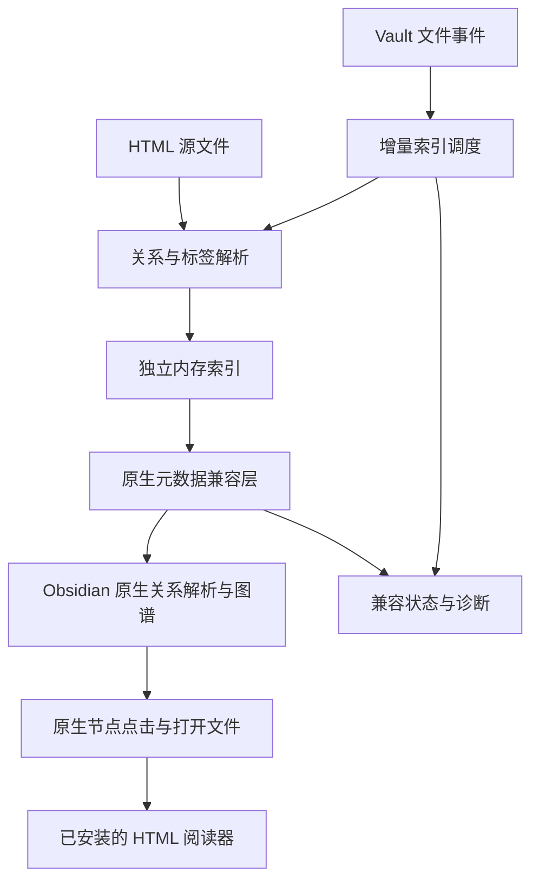

# HTML Graph 架构建议

> 范围已调整：本文保留为此前图谱研究。当前只处理 HTML 的 frontmatter / Properties，不依赖第三方 HTML 插件，以 [当前属性架构](frontmatter-architecture.md) 为准。

调研日期：2026-10-15。状态：本文的图谱方案只有接口证据和离线契约验证，未实现该图谱方案，也未完成真实图谱 UI 验证。当前已实现的单文件属性原型见 [验证记录](prototype-verification.md)。

## 1. 推荐结论

采用**独立内存索引 + 原生元数据兼容层 + 现有 HTML 阅读器**。

插件从 HTML 源文件读取显式关系和标签，在内存中建立索引，通过范围受限的兼容层向原生关系图谱提供数据。图谱布局、绘制和节点点击沿用 Obsidian；HTML 显示继续交给已有阅读插件。

这一方案符合“每主题一份 HTML、直接使用原生图谱”的方向，也把对非公开接口的依赖集中在一个模块内。

不生成辅助 Markdown，不建立独立图谱，不复制 HTML 正文，不修改 Obsidian 安装文件或持久化索引数据库。

这是当前证据下最值得先验证的架构，不是已确认稳定的成品方案。依据见 [接口调研](obsidian-interface-research.md)，开发顺序见 [开发前置与验证计划](development-plan.md)。

## 2. 方案比较

| 方案 | 对本项目的判断 | 原因 |
| --- | --- | --- |
| 只注册 HTML 视图 | 不足以实现目标 | 解决显示，未提供正文关系与标签索引 |
| 只向 `resolvedLinks` 写值 | 不作为架构 | 图谱文件连线可消费该值，但标签仍需元数据，且原生重解析可能覆盖派生值 |
| **独立索引 + 范围受限的原生兼容层** | **推荐先验证** | 保持 HTML 唯一正文，复用原生图谱，将易变接口隔离 |
| 直接修改图谱 renderer 或绘制数据 | 暂不采用 | 当前数据构造器已经能消费目标信息，尚无必要增加绘制层耦合 |
| 辅助 Markdown | 保留为需另行讨论的替代路线 | 与当前优先直接适配的选择不同，不能静默切换 |
| 自建图谱 | 不在当前目标内 | 无法直接满足使用 Obsidian 原生图谱的要求 |

## 3. 模块边界



### 3.1 Parser：解析源文件，不运行页面

- 输入 HTML 字符串和源文件的库内路径。
- 读取受支持的元数据与显式关系链接，保留原始属性值、片段和源码位置。
- 不运行脚本，不请求资源，不依赖页面已经打开，也不扫描运行时 DOM。
- 不把 CSS、图片、字体、脚本依赖或普通页面导航自动当成知识关系。

建议采用有源码位置支持的纯 HTML 解析器，首选考察 `parse5`。其 `sourceCodeLocationInfo` 和属性位置能为之后的精确写回保留依据。`scriptingEnabled` 影响 HTML 解析规则，不是执行脚本的开关。[解析器选项](https://parse5.js.org/interfaces/parse5.ParserOptions.html)、[属性位置](https://parse5.js.org/interfaces/parse5.Token.ElementLocation.html)

### 3.2 Index：插件自己的唯一派生索引

- 以真实库内路径为键，保存标签、链接、解析诊断和文件修订号。
- 记录哪些 HTML 已明确启用适配，避免整库所有网页都进入知识图谱。
- 区分原始 `href`、规范化目标路径和已解析目标，不能混为一个字段。
- 原始 HTML 是内容真相；内存索引和原生关系映射都可重建。
- 初期不引入数据库，不把派生元数据写进 Obsidian 的私有持久化缓存。

### 3.3 Controller：增量调度与生命周期

- 启动时按约定范围扫描 HTML；后续监听 `create / modify / delete / rename`。
- 对修改事件合并处理，使用每文件修订号或任务代号，拒绝过期异步结果。
- 文件被删除后立即清理其索引和已发布关系。
- 文件或目录移动后重新计算受影响的相对路径关系。
- 元数据暂时无效时保留上次有效结果并明确标记过期；删除事件不能沿用旧结果。
- 停用时先阻止新任务，撤销自身兼容层，再清理拥有的数据与通知图谱刷新。

### 3.4 NativeMetadataBridge：集中管理所有易变接口

职责是让内核读取 HTML 的派生元数据和关系，不承担 HTML 显示。

已知需要验证的接入点：

1. 对已纳管 HTML，范围受限地覆盖 `MetadataCache.getCache(path)` 的返回结果；其他文件完全委托原函数。`getFileCache()` 在本机版本中会调用 `getCache()`，暂不重复包装。
2. 在索引更新后使用原生关系解析调度，确认解析完成事件能刷新全局与局部图谱。
3. 核对普通 HTML 相对路径与 Obsidian 模糊链接解析的差异。若原生解析无法保持路径契约，再增加仅针对已纳管 HTML 的 `resolveLinks` 包装，由插件提供精确结果；不要预先增加未证明必要的钩子。
4. 图谱能读取 HTML 标签，不代表原生标签面板已经支持。若需要标签面板和跨文件标签大小写统一，再单独验证 `getTags()` 合并包装。

本机不存在公开的“注册 HTML 元数据解析器”接口。公开属性 `resolvedLinks` 的存在，也不构成外部写入行为受官方兼容性保证的证明。[官方 API 定义](https://github.com/obsidianmd/obsidian-api/blob/9abd9605ce081383674aae1ed111c456edde0688/obsidian.d.ts)

兼容层必须满足：

- 修改实例上的有限入口，不修改全局原型。
- 私有类型、能力探测和安装/撤销逻辑只存在于该模块。
- 能力检查通过后再整体启用，失败时不留下半套包装。
- 未纳管 HTML、Markdown、Canvas 和其他文件沿用原行为。
- 虚拟元数据只暴露已经支持的 links/tags，位置指向真实 HTML 源码；不伪造原生 frontmatter 或宣称原生属性编辑可用。
- 只清理自己产生且仍可确认归属的数据，不覆盖其他插件的更新。
- 撤销时若方法已被其他插件再次包装，不强行覆盖后来的包装；需要停用标记及包装顺序测试。
- 不修改 `fileCache` 的 hash、不调用 `saveMetaCache` 伪造持久化记录。
- 不自动改变用户的图谱开关。

### 3.5 Diagnostics：让失败能够被解释

最少提供兼容状态、已纳管文件数、解析错误、未支持链接、过期索引，以及重建索引命令。

诊断不输出整篇 HTML、脚本内容或完整个人笔记清单。没有必要引入独立仪表盘。

## 4. HTML 关系声明建议

以下为推荐的 v1 契约，需在最小原型前固定成规范；当前未据此批量修改任何笔记。

### 4.1 元数据与主动纳管

```html
<script type="application/json" id="html-graph-metadata">
{
  "version": 1,
  "tags": ["课程/数据库", "关系理论"]
}
</script>
```

- 出现合法且唯一的该数据块，表示该 HTML 主动参与适配。
- JSON 数据只被解析，不被执行。
- 标签值不带开头的 `#`，校验后转成图谱需要的形式；嵌套标签保留 `/`。
- 该数据块不等于原生 YAML frontmatter，不宣称支持原生属性编辑。
- 暂不在 JSON 中再复制一份链接列表，以免与正文产生两个来源。

### 4.2 显式关系链接

```html
<a href="./函数依赖.html" data-html-graph-link>理解规范化所需的函数依赖</a>
```

建议只索引带 `data-html-graph-link` 的链接。它仍然是普通可点击 HTML 超链接；标记用于表达“这条链接应进入知识图谱”。页眉导航、课件来源、资源链接不自动产生大量连线。

首轮支持范围：

| 链接形式 | 建议处理 |
| --- | --- |
| `./主题.html`、`../主题.htm`、相对 `.md` 链接 | 按源文件目录精确解析 |
| `/课程/主题.html` | 约定为库根相对路径，须在规范和作者模板中明确 |
| `主题.html#section` | 文件级图谱边；片段另存，不生成标题节点 |
| `#section` | 页内导航，不生成文件关系 |
| 中文、空格、百分号编码 | 进行一致的 URL 解码与路径校验，不能对整条 URL 盲目解码 |
| `http(s):`、`mailto:`、`javascript:`、机器绝对路径 | 不作为库内关系 |
| 无扩展名、查询参数、`obsidian:`、`<base href>` | 首轮不承诺支持，诊断中说明；避免猜测目标 |
| 资源文件链接、脚本动态生成的链接、文本中的 `[[链接]]` | 不在首轮关系契约内 |

解析不得越出库根。相对 HTML 链接不能因精确目标不存在，就任意匹配其他目录中的同名文件。

## 5. 图谱与阅读器的边界

- HTML 在本机原生图谱中被分类为附件；需要用户启用“显示附件”。标签连线还需要启用“显示标签”。
- 第一版接受附件节点样式，不为外观去修改原生附件分类器。
- 原生图谱点击文件节点会调用打开链接流程，预计可沿用已注册阅读器；必须在测试库实测后才算通过。
- 本插件不再注册 `.html/.htm` 文件扩展名。本机已存在处理器，重复注册会抛错。
- 原生标签节点点击会启动标签搜索。HTML 标签在图中可见，不代表原生标签搜索已经收录 HTML；不承诺这条点击路径返回 HTML 结果。
- 图谱标签/属性筛选、悬浮预览、完整反向链接面板、页面内部跳转，不自动随基础图谱接入完成，均需独立验证或另行纳入范围。
- 最小原型以默认无筛选的全局图谱和局部图谱为验收入口，不能用“数据存在”替代 UI 验证。

## 6. 改名与写回分期

### 第一期：只读索引

文件改名、移动后，索引正确迁移并重解析。源 HTML 的旧 `href` 若已失效，应成为未解析关系或清除旧实线，不能偷偷保留一条已经无效的边。

这一阶段不承诺自动维持所有源链接有效，因此只是可行性原型，不能宣称“改名无损”的可用成品。

### 第二期：独立的精确链接写回

确有需要后，再实现独立的 RenameService，并研究 Canvas 的内部 `linkUpdaters` 接入方式。

关键约束：

- 原生链接更新器生成的是 Markdown 替换文本，不能直接写进 HTML 的 `href`。
- 必须基于改名前的目标身份、原始属性范围和最新源内容，重新计算 HTML URL。
- 只替换目标属性的必要字符，不重新序列化整个页面。
- 保留引号、实体、片段、样式、脚本及无关空白；修订不一致时放弃本次写入并重新计算。
- 区分移动目标文件与移动来源 HTML，后者可能使该页所有相对路径失效。
- 尊重用户的自动更新链接偏好，并在测试库验证多文件/目录操作。
- `linkUpdaters` 注册与撤销属于私有机制；未实现正确的写回语义前，不把只读引用伪装成可更新引用交给该机制。

## 7. 实现与目录建议

正式编写原型时采用 TypeScript、官方 Obsidian 类型和 esbuild；不需要 UI 框架、服务器或数据库。测试优先使用 Node 自带测试能力，图谱接入另做真实应用验证。

建议在需要时创建以下模块，而不是现在生成空目录：

```text
src/
  main.ts
  html/             解析、元数据校验、源码位置
  index/            路径解析、内存索引、增量调度
  compat/           Obsidian 内部接口、包装与撤销
  diagnostics.ts
```

RenameService 在第二期再添加。模块按职责拆分，不必一开始将每个函数拆成独立文件。

插件运行时代码优先使用 Vault API 和跨平台 JavaScript；Node/Electron 只用于本地构建、CLI 和调研脚本。Windows 1.14.4 为首个验证目标，Android 需要真实设备另验，桌面模拟不等于移动端通过。

仓库目录名 `obsidian-html-graph` 可以保留。未来 manifest 的插件 ID 需另定，例如先考察 `html-graph` 是否可用；官方要求 ID 不能包含 `obsidian`。项目目录名与发布 ID 不需要相同，但测试库的插件目录必须匹配 manifest ID。[Manifest 规范](https://raw.githubusercontent.com/obsidianmd/obsidian-developer-docs/c56c7e770ba25dd0ea392aacf4588f9425970d36/en/Reference/Manifest.md)
