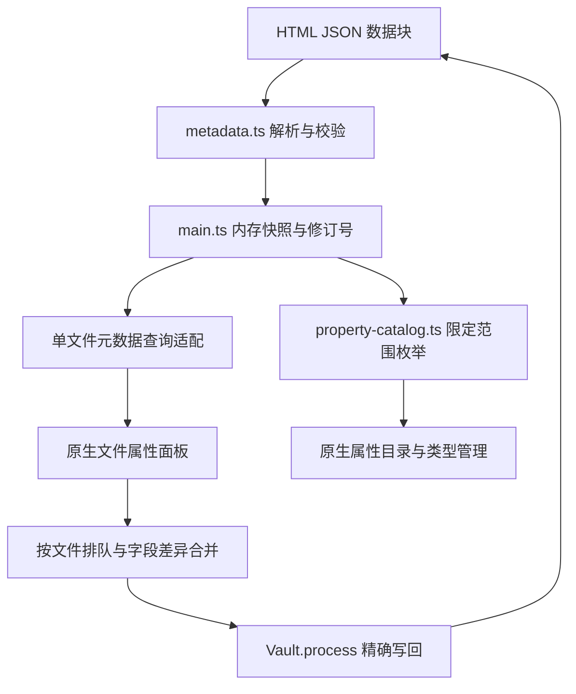

# HTML Frontmatter 架构与接口边界

适用于插件 0.1.2、桌面 Obsidian 1.14.4。运行时使用部分非公开接口，其他版本拒绝加载。实际检查与未覆盖情形见[验证记录](prototype-verification.md)。

## 产品边界

插件把 HTML 内的 JSON 属性映射到原生 Properties，支持单文件编辑及全库属性目录、计数与候选值。不依赖第三方 HTML 插件，不注册 HTML 正文视图。

| 能力 | 状态 |
| --- | --- |
| 文件内属性存储 | JSON 数据块解析、校验与精确写回 |
| 单文件属性面板 | 原生控件编辑七类属性，支持新增、改名和删除 |
| 全库属性目录 | HTML、HTM 与 Markdown 的属性合并计数，提供原生候选值读取 |
| 属性类型 | 复用原生类型管理；同名 Markdown 属性协作、显式类型选择与重启保留已验证 |
| 全局属性改名、删除 | 涉及 HTML 时阻止，包含原生目录的混合批量删除 |
| 原生标签侧栏、搜索、反链、图谱、Bases | 不提供适配；tags 字段可编辑不代表这些功能包含 HTML |

## 文件格式

属性保存在唯一的非执行数据块中：

```html
<script type="application/json" id="obsidian-frontmatter">
{
  "project": "Example",
  "completed": false,
  "tags": ["demo/example"]
}
</script>
```

采用 JSON 是为了直接保存基础类型与列表，并使用 HTML 数据块机制；不在文档前添加裸 YAML。`obsidian-frontmatter` 标识和字段规则属于本插件约定，不是 Obsidian 或其他软件自动识别的通用 HTML frontmatter 标准。

`src/metadata.ts` 使用 parse5 定位源码区间。已有数据块只替换内部 JSON，不重新序列化整份 HTML；没有块时插入一个。无效、重复或不受支持的数据块拒绝写入。字符串中的 `<`、U+2028 和 U+2029 转义后保存，避免结束标签提前终止数据块。

缺失字段、`null`、空字符串、`false`、`0` 与空列表保持区别。写入以字段差异合并到最新源码：保留其他字段的外部更新，同字段冲突拒绝覆盖。完整格式及文件 Agent 的使用方式见[读写约定](agent-guide.md)。

## 数据流与源码分工



| 文件 | 职责 |
| --- | --- |
| `src/metadata.ts` | 纯文本解析、属性校验、差异计算、冲突处理与写回 |
| `src/main.ts` | 生命周期、HTML 发现与内存索引、修订号、按文件写入队列、面板适配、全局操作保护 |
| `src/property-catalog.ts` | 属性功能执行期间临时补入 HTML 枚举，停用时恢复原方法 |
| `src/compat.ts` | 非公开接口类型、视图识别和可撤销方法包装 |

没有独立持久化索引，不把虚拟 HTML 元数据写入 Obsidian 的原生 hash 数据库。监听文件修改、移动、删除和排除规则变化，刷新内存状态与目录。

## 1.14.4 接口限制与适配方式

初始只读源码检查见 [frontmatter-source-1.14.4.json](research/frontmatter-source-1.14.4.json)。该记录只证明源码入口与限制，面板、保存及重启结果另记在验证记录中。

**文件属性视图。** 原生 `file-properties` 的支持判定、属性解析和保存均包含 Markdown 假设，且保存不经过 `processFrontMatter()`。插件对具体视图实例适配支持判定、加载与保存，固定所选文件；HTML 正文无须在编辑区打开。Properties 核心插件关闭时给出提示。

**单文件查询与写入。** 原生 `getCache()` 对非 Markdown 返回空对象，`processFrontMatter()` 对非 Markdown 提前返回。插件为已纳管 HTML 提供属性查询与写入转发，其余文件委托原实现。

**全库目录。** 原生目录和候选值依赖 `iterateFileCache()`，并非简单调用已覆盖的单文件查询。插件仅在属性目录重建、计数、候选值读取和类型管理器 `changed` 事件分发期间补入 HTML。预注册监听器持有原始函数引用，因此事件分发也需覆盖。同步作用域以 `try/finally` 恢复；普通枚举保持原行为。

**全局操作保护。** 原生全局属性改名通过 Markdown 规则直接处理文件，不走统一写入入口。插件在涉及 HTML 的全局改名、删除前拒绝调用；目录混合批量删除预检整批选择，避免先修改 Markdown 再失败。Markdown 专属属性的独立全局操作保持原行为，HTML 单文件面板内的改名、删除仍可用。该保护不构成对其他程序多个独立 API 调用的跨调用事务。

**生命周期。** 方法包装、视图适配和事件监听在停用时撤销；文件写入按文件排队，索引使用修订号防止旧异步任务覆盖新状态。兼容版本与必要方法检查不通过时停止启用。

## 验证边界

Windows 桌面 1.14.4 的独立合成测试库已覆盖存储完整性、真实原生控件、目录更新、全局操作保护、停用恢复及完整重启。0.1.2 的针对性复核为 15 个单元测试、14 项基础界面检查与 13 项目录检查；扩展类型和重启证据来自较早开发阶段。

其他 Obsidian 版本、移动端、多窗口并发、长期大量文件性能及其他社区插件组合未验证。目录项点击仍进入原生搜索，其结果不保证包含 HTML；属性存储也不等于 aliases 等特殊语义完整可用。
