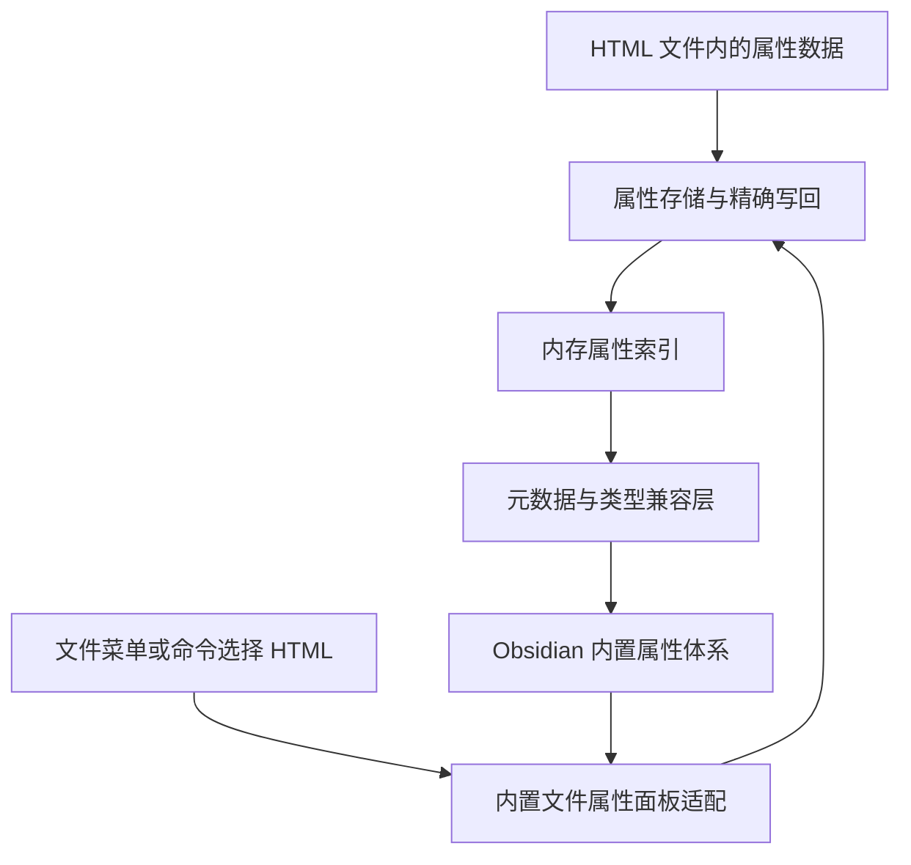

# HTML 与 Obsidian 属性体系适配

调研与原型日期：2026-10-15。当前阶段：单文件编辑与全库属性目录、统计、候选值适配均已在独立测试实例通过；完整结果见 [原型验证记录](prototype-verification.md)。下文保留完整属性体系的设计目标，不能将其全部视为已实现。

## 1. 当前范围与结论

当前项目只处理 HTML 的 frontmatter / Properties 适配，不依赖任何第三方 HTML 插件。

目标是让 HTML 文件的属性能够通过 Obsidian 内置属性面板读取、编辑和保存，并尽可能参与原生属性类型、标签与全库属性管理。

HTML 正文渲染、页面交互、正文链接解析、图谱增强和自动改名链接均不属于当前范围。以前的图谱架构文档保留为背景研究，不作为当前实施计划。

结论是：**直接适配已跑通单文件编辑和全库属性目录，全部原生属性功能仍未覆盖。** 实现同时处理存储、单文件元数据查询、属性范围内的枚举、原生面板和写回通路；这些适配含有本机版本的内部接口依赖。

## 2. “加入 frontmatter 体系”需要区分的层次

| 层次 | 含义 | 当前判断 |
| --- | --- | --- |
| 文件内存储 | 属性随 HTML 文件保存与同步 | JSON 数据块读写、正文保留已验证；同步软件行为未测试 |
| 单文件属性面板 | 复用内置 File properties 控件编辑属性 | 原型已验证读取、编辑、新增、删除、单文件改名 |
| 原生类型 | 文本、列表、数字、复选框、日期、日期时间、标签 | 七类控件已实测；显式列表/日期/日期时间类型选择、同名 Markdown 属性协作及重启保留已验证 |
| 全库属性目录 | 属性名、类型、出现次数和建议值 | 已验证 HTML 专属属性、合并计数、标量/列表候选值、排除规则、更新与停用恢复 |
| 全局属性操作 | 重命名、删除等操作作用于多个文件 | 原型已拦截涉及 HTML 的全局重命名和删除，尚不执行全局修改 |
| 其他原生能力 | 搜索、Bases、反链、图谱、别名等 | 不随本期适配自动承诺，不作为首轮验收范围 |

官方说明中，Properties 是有类型的结构化信息，原生笔记的属性通常以顶部 YAML 保存；内置属性视图分为当前文件属性和全库属性两类。[Properties](https://obsidian.md/help/properties)、[Properties view](https://obsidian.md/help/plugins/properties)

## 3. 本机 1.14.4 的关键发现

本节为原型开发前的只读调查发现；六项源码检查记录见 [frontmatter-source-1.14.4.json](research/frontmatter-source-1.14.4.json)。后续真实面板与写入实验使用独立测试库，结果另见验证记录。

### 3.1 原生文件属性视图有多处 Markdown 限制

`file-properties` 视图可接受任意扩展名的文件绑定，但其内部仍然：

- 在 `isSupportedFile()` 中只接受 `.md`。
- 根据这一判断决定是否读取文件、显示控件及绑定可修改文件。
- 在 `updateFrontmatter()` 中按顶部 Markdown frontmatter 解析正文。
- 在 `saveFrontmatter()` 中再次检查 `.md`，随后直接调用 `Vault.process()`，按 Markdown 规则保存。

因此，仅覆盖元数据查询，或仅适配 `FileManager.processFrontMatter()`，都不足以让这个原生面板正常编辑 HTML。

### 3.2 公开读写 API 也不是通用扩展名入口

- `MetadataCache.getCache()` 对非 Markdown 文件返回空对象。
- 本机 `FileManager.processFrontMatter()` 对非 `.md` 提前返回。
- 原生面板的保存绕过了 `processFrontMatter()`，需要单独处理。

官方有 `processFrontMatter()` 的公开类型，但没有公开的 HTML 属性存储适配器或原生属性编辑器注册入口。[固定版本 API](https://github.com/obsidianmd/obsidian-api/blob/9abd9605ce081383674aae1ed111c456edde0688/obsidian.d.ts)

### 3.3 全库目录不是单文件缓存的简单汇总

本机 `MetadataTypeManager` 负责属性类型和目录；该对象未出现在已查的公开类型声明中。

其属性重建、出现次数统计，以及属性候选值获取，依赖 `iterateFileCache()`。该枚举直接读取原生 hash 缓存，不会因 `getCache()` 被覆盖而自动包含 HTML。

因此，需要分别验证：单文件查询、全库枚举、类型管理刷新和属性面板更新。

当前实现已分别处理这些入口：只有原生属性目录重建、计数、候选值读取，以及类型管理器的 `changed` 事件期间，枚举才会补入 HTML。普通 `iterateFileCache()` 调用保留原行为。该边界避免把图谱和搜索当作属性目录适配的附带功能。

### 3.4 全局重命名不能放任原生逻辑处理 HTML

本机 `FileManager.renameProperty()` 会读取文件属性后，直接用 Markdown frontmatter 规则转换文件内容并写回，不走统一的 `processFrontMatter()`。

一旦 HTML 的虚拟 frontmatter 被暴露给原生查询，这条全局操作也可能看到它。不能只写“暂不支持”就忽略该入口；必须在暴露数据前确保相关操作会被正确转发或明确拦截。

未实现安全写回时，遇到涉及已纳管 HTML 的全局重命名，应阻止该操作并说明限制，不能静默跳过 HTML 后显示全局操作成功。

## 4. 不依赖第三方 HTML 插件的入口

推荐提供“编辑 HTML 属性”的文件菜单与命令入口，直接绑定真实 HTML 文件到 Obsidian 内置的文件属性侧栏。

该入口的设计候选是：先创建或取得 `file-properties` 视图，在纳管其 HTML 行为后设置文件状态，再刷新属性；不能假设注册面板与首次加载文件之间的时序已经解决。

- 不注册 `.html/.htm` 的正文显示处理器。
- 不访问第三方阅读器对象，不要求安装任何外部 HTML 插件。
- 不执行 HTML 内容或加载页面资源。
- 原生 Properties 核心功能若被关闭，应明确提示，不自动更改用户配置。
- 即使 HTML 没有在编辑区打开，也应能通过明确的文件选择入口编辑其属性。

原型已在只启用核心插件与本项目插件的独立测试库中验证该入口。首次绑定前安装视图实例适配；同一文件重开时复用已有侧栏，并固定文件绑定，不要求正文阅读器。

## 5. 属性的底层存储：实现选择与语义区别

用户已明确以达到目的为准，不要求底层使用 YAML 或其他特定格式。实现选择采用 HTML 内的非执行 JSON 数据块，以单文件保存、原生面板读写和正文完整性作为判断标准。

### 当前选择：HTML 内 JSON 数据块

```html
<script type="application/json" id="obsidian-frontmatter">
{
  "课程": "数据库",
  "章节": 6,
  "tags": ["课程/数据库"],
  "完成": false
}
</script>
```

- 属性与正文保存在同一个 HTML 文件中。
- 原生面板编辑的数据由插件映射到这个数据块，读写原生属性语义。
- 数据块不执行脚本，也不意味着提供 HTML 渲染功能。
- 保存时只替换元数据区域；HTML 的正文、样式、脚本与其他区域保持原样。
- JSON 中的 `<` 等字符需要适当转义，避免属性值中的结束标签提前终止数据块。
- 只有合法、唯一、受支持的数据块才进入读写流程；无效或重复块应报告问题，不能自动清空覆盖。

选择 JSON 是因为它可以直接保存属性对象、列表、数字与布尔值，放入 HTML 数据块后也无需把裸 YAML 加到文档之前。通过插件完成与原生属性面板的映射，学习者无需手工维护 JSON。

**这是由本插件提供的属性语义适配，不是 Obsidian 已有的 HTML JSON 自动识别功能。实际读写和原生界面接入已通过原型验证。**

### 其他存储形式

| 形式 | 判断 |
| --- | --- |
| HTML 之前直接放 `---` YAML | 不推荐；会干扰普通 HTML 文档的解析与显示，且不会自动消除原生扩展名限制 |
| HTML 注释内 YAML | 本期不采用；还需处理注释终止符、非法内容与精确写回 |
| HTML 内非执行 YAML 数据块 | 本期不采用；同样要处理结束标签和 YAML 类型往返，当前没有必须保留 YAML 源文本的需求 |
| 辅助 Markdown 或独立元数据文件 | 不是当前默认方案，需要另行讨论才可切换 |

## 6. 推荐架构



### MetadataStore

负责解析、校验、存储区域定位和读改写。使用 `Vault.process()` 基于最新源内容更新，保留元数据区域以外的源字符串，不重新序列化整个 HTML。

必须保留类型差异：缺失字段、`null`、空字符串、`false`、`0`、空列表不能互相替代。日期和日期时间需按原生约定往返；不自行变成不同类型。

### PropertyIndex

独立持有 HTML 的属性快照、修订信息与诊断。监听文件修改、移动、删除；没有持久化索引数据库，也不把内容写进私有 hash 缓存。

### MetadataCompatibility

已实现范围受限的单文件缓存覆盖、属性操作期间的 HTML 枚举、类型目录刷新，以及 `processFrontMatter()` 转发。目录、计数、排序、类型推断与候选值规则仍由原生方法执行，不复制一套统计逻辑。

属性类型管理器在插件加载前已注册原始重建函数作为事件监听器，因此除方法本身外，还需要在其 `changed` 事件分发期间开启属性枚举范围。同步范围以 `try/finally` 结束；不会把 HTML 写入原生 hash 缓存。该同步调用契约已在 1.14.4 检查并有错误退出测试。

只对已纳管 HTML 生效；Markdown 和其他文件委托原实现。兼容层需要可撤销、可检测冲突，并在不支持的版本拒绝部分启用。

### NativePropertiesAdapter

负责原生文件属性面板的 HTML 支持判定、属性加载与保存。优先适配具体视图实例，不直接修改全局视图原型。

需要覆盖新建面板、已有面板、延迟视图、首次绑定、切换文件、外部修改和停用后的恢复。不以“改一个扩展名判断”代替完整生命周期适配。

### PropertyOperationGuard

处理全局属性重命名、删除等入口。完整支持前先识别并阻止危险路径，明确告诉用户哪些操作尚不能完成；不能让原生 Markdown 写入器触碰已纳管 HTML。

原生全库目录的批量删除会逐项调用视图 `deleteProperty()`。当前在该视图实例预检整批选择，包含 HTML 属性时在首项写入前阻止；单属性的 FileManager 入口继续保留保护。Markdown 专属属性的单独全局改名和删除不受影响。

## 7. 首版验证范围

当前原型已覆盖下列目标的主要路径，具体类型、场景和未覆盖边界见验证记录：

1. 不安装第三方 HTML 插件，选择一个 HTML 并打开原生属性面板。
2. 显示、增加、修改、删除、单文件重命名属性。
3. 常用类型和 `tags` 能正确往返，重开应用后保留。
4. 元数据区域之外的文件内容逐字符保持不变。
5. 修改源文件后面板与索引更新，不由旧任务覆盖新内容。
6. 同名属性遵循原生类型配置；全库目录与次数没有重复或残留。
7. 全局操作得到安全支持或明确阻止，不产生部分成功假象。
8. 无效属性块不被覆盖；插件停用后原生 Markdown 行为恢复正常。

单文件闭环通过前，不把这一工作扩展到 HTML 渲染、正文图谱或其他笔记系统功能。

## 8. 当前验证状态

已完成：本机只读接口检查、公开 API 对照、JSON 精确写回与字段冲突处理、真实原生面板七类控件编辑和单文件结构操作、外部修改刷新、无效数据拒绝写入、全局操作保护、停用恢复、完整应用重启。扩展验证还覆盖显式类型选择持久化、同名 Markdown 类型协作、连续输入、排队写入和切换文件后的写入目标。

本阶段另已完成：HTML 全库属性目录、合并计数、候选值、文件变动和排除规则刷新、混合批量删除保护、目录停用恢复与完整重启。

未完成：HTML 全局改名和删除的实际执行、目录项对应的 HTML 搜索结果、aliases 等特殊属性语义、其他平台和版本适配。此前图谱的 10 个离线用例仍不构成这些能力已通过的证据。

底层采用 JSON 数据块，不把格式选择作为等待用户决定的事项，也不把外部 HTML 阅读器作为依赖。本轮停止在独立测试原型，不部署到日常库。
